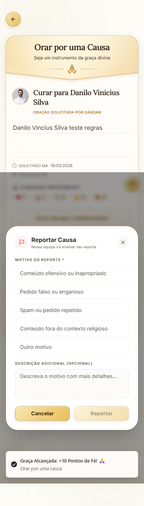
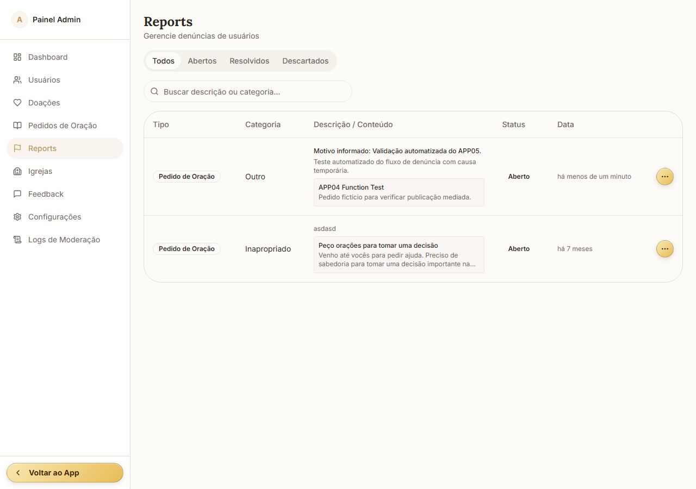

# APP05 — Relatório final de validação

**Tema:** Denúncias de causas, usuários, remetentes e contribuições  
**Branch:** `codex/feature/app05-reporting`  
**Status:** Validado no fluxo principal

## Resumo

O fluxo de denúncias do Améns foi implementado e validado no navegador. A
denúncia foi aberta a partir de uma causa de oração, preenchida com a categoria
`Outro`, enviada com motivo e descrição adicionais e confirmada no painel
administrativo.

Também foi removido temporariamente o limite diário de oportunidades de oração,
permitindo repetir os testes com as contas fictícias sem bloqueio.

## Alterações realizadas

- Adicionada denúncia de usuários na Comunidade.
- Adicionada denúncia do remetente em Mensagens quando a notificação possui
  `sender_id`.
- Adicionada denúncia de contribuições na Corrente de Oração.
- Mantida a denúncia de causas em `/pray`.
- Adicionada a coluna `notifications.sender_id` e seu índice no Supabase.
- Novas notificações passam a registrar o remetente.
- Implementados recursos de acessibilidade nos diálogos:
  - nome acessível;
  - botão de fechar;
  - fechamento com Escape;
  - foco inicial e restauração do foco;
  - estado acessível das categorias;
  - associação entre campos e descrições.
- Removido temporariamente o bloqueio diário de intercessões para permitir os
  testes repetidos do APP05.

## Teste executado

1. Login realizado com uma conta fictícia de administrador.
2. Causa de oração recebida sem bloqueio de oportunidade.
3. Botão `Reportar essa causa a um administrador` acionado.
4. Categoria `Outro motivo` selecionada.
5. Motivo personalizado e descrição adicional preenchidos.
6. Denúncia enviada com sucesso.
7. Diálogo fechado automaticamente após o envio.
8. Registro conferido em `/admin/reports`.

## Evidência 1 — Diálogo de denúncia em tela móvel

A captura demonstra o diálogo em viewport de 390 px, com o título do alvo,
categorias, campo de motivo personalizado, descrição adicional e botões de
cancelamento e envio.

## Evidência 2 — Registro no painel administrativo

O painel exibiu o novo registro com:

- **Tipo:** Pedido de Oração;
- **Categoria:** Outro;
- **Status:** Aberto;
- **Motivo:** Validação automatizada do APP05;
- **Descrição:** Teste automatizado do fluxo de denúncia com causa temporária.

O denunciante não é exposto na listagem pública da denúncia.

## Validações técnicas

- `npm run build`: aprovado.
- `git diff --check`: sem erros de conteúdo.
- Migration de `notifications.sender_id`: aplicada e confirmada no Supabase.
- Consulta REST de `sender_id`: HTTP 200.
- Migration de remoção temporária do limite diário criada:
  `supabase/migrations/20261123000000_disable_prayer_daily_limit_for_testing.sql`.

## Observações

- O report antigo de sete meses atrás permanece no painel e não pertence ao
  teste atual.
- O novo report de teste permanece aberto para permitir a análise no painel.
- O limite diário foi removido temporariamente para validação e poderá ser
  reativado posteriormente com uma nova decisão de produto.

## Conclusão

O fluxo principal do APP05 foi concluído e aprovado: o usuário consegue abrir,
preencher e enviar uma denúncia, e a equipe administrativa recebe o registro
com o tipo, categoria, motivo, descrição e status corretos.
