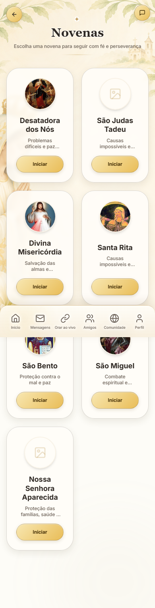
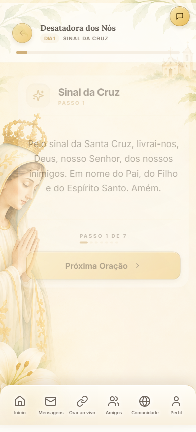

# APP08 — Novenas, progresso e lembretes

**Status:** Concluído e validado  
**Branch:** `codex/feature/app08-novenas-validation`

## Escopo identificado

- Catálogo de novenas em `/novenas`.
- Abertura de uma novena em `/novena/:id`.
- Progresso local por dia, retomada e reinício.
- Conclusão do dia e conclusão dos nove dias.
- Novena especial da Divina Misericórdia.
- Lembrete diário e restauração de lembretes no aplicativo nativo.
- Rota inválida e acessibilidade por teclado.

## Matriz de testes

| Caso | Validação | Estado |
| --- | --- | --- |
| APP08-T01 | Catálogo e cards disponíveis | Aprovado: 7 novenas |
| APP08-T02 | Abertura e rota inválida | Aprovado |
| APP08-T03 | Avanço, retorno e conclusão do dia | Aprovado |
| APP08-T04 | Persistência e retomada do progresso | Aprovado |
| APP08-T05 | Reinício de novena com confirmação | Aprovado |
| APP08-T06 | Conclusão do nono dia | Aprovado |
| APP08-T07 | Divina Misericórdia e etapa interativa | Aprovado |
| APP08-T08 | Lembrete, cancelamento e horário inválido | Aprovado em dispositivo |
| APP08-T09 | Teclado, 320 px, paisagem e textos longos | Aprovado |
| APP08-T10 | Build e validação estática | Aprovado |

## Riscos a verificar

- O progresso é salvo no `localStorage`, portanto precisa ser isolado por
  novena e não pode misturar dias entre catálogos.
- Lembretes dependem da plataforma nativa e da permissão de notificações.
- A conclusão do dia registra evento no altar e não deve duplicá-lo.
- As imagens externas das novenas podem falhar sem uma alternativa visual.

## Execução E2E — 26/11/2026

- Catálogo: 7 cards disponíveis e acionáveis.
- Teclado: card da primeira novena aberto com `Enter`.
- Progresso: Dia 1 concluído, salvo no `localStorage` e retomado no Dia 2.
- Lembrete: horário salvo no ambiente web sem plataforma nativa.
- Divina Misericórdia: etapa “Terço da Misericórdia” e conta grande exibidas.
- Conclusão: estado do Dia 9 exibiu “Novena Concluída!” e retornou ao catálogo.
- Rota inválida: mensagem “Novena não encontrada” e retorno disponíveis.
- Responsividade: 320 × 844 sem overflow horizontal.
- Testes nativos: o responsável confirmou lembrete, cancelamento, modo
  paisagem e recebimento com o aplicativo fechado funcionando corretamente.

### Evidências

## Conclusão

O APP08 está concluído. O catálogo de novenas, o fluxo diário, a persistência,
a retomada, o reinício, a conclusão, a Divina Misericórdia, os lembretes, a
acessibilidade e a responsividade foram validados no navegador e no dispositivo
real.
