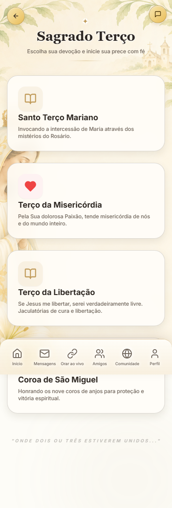
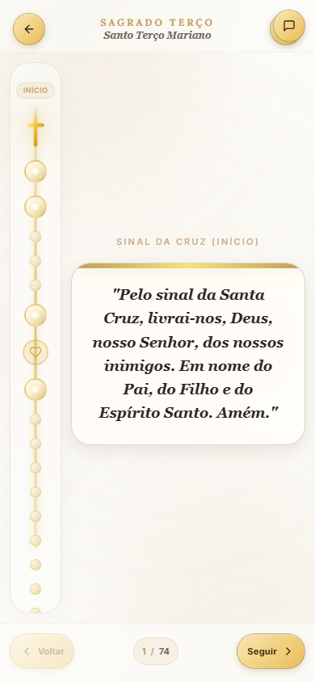
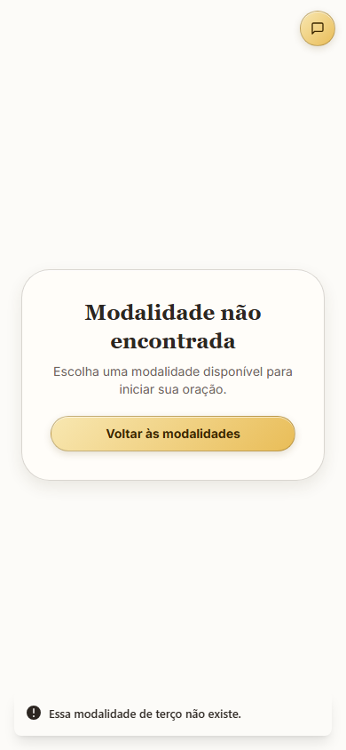
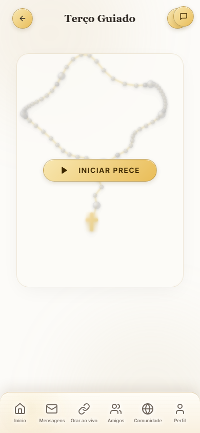

# APP09 — Relatório final do Sagrado Terço

**Status:** Concluído e validado  
**Branch:** `codex/feature/app09-sacred-rosary`  
**Último commit:** `2ab3174`

## Resumo

O APP09 foi validado com as quatro modalidades do Sagrado Terço, o fluxo
legado `/terco`, navegação manual, tratamento de rota inválida, acessibilidade
por teclado, telas móveis, paisagem, redução de movimento e integração com o
altar.

Por decisão do produto, o uso de microfone e reconhecimento de voz foi removido
completamente. O terço funciona exclusivamente pelos controles manuais.

## Modalidades testadas

| Modalidade | Sequência | Resultado |
| --- | ---: | --- |
| Santo Terço Mariano | 74 contas | Aprovado |
| Terço da Misericórdia | 62 contas | Aprovado |
| Terço da Libertação | 59 contas | Aprovado |
| Coroa de São Miguel | 50 contas | Aprovado |
| Terço legado `/terco` | 72 avanços | Aprovado |

Em todas as modalidades, os controles manuais permitiram avançar, voltar e
concluir. Após a conclusão, o fluxo retornou à página inicial.

## Evidência 1 — Seleção das modalidades

A tela apresenta as quatro modalidades disponíveis. Os cards foram convertidos
em botões semânticos, com foco visível e nomes acessíveis para teclado.

## Evidência 2 — Oração por contas

A tela exibe a conta ativa, a oração correspondente, o contador da sequência,
os controles de conta anterior e próxima conta e o botão de conclusão.

## Evidência 3 — Tratamento de modalidade inválida

Uma URL inválida não deixa mais a tela vazia. O usuário recebe uma mensagem
clara e pode retornar à seleção de modalidades.

## Evidência 4 — Fluxo legado `/terco`

O fluxo legado foi aberto, iniciado, percorrido manualmente e concluído,
exibindo a tela final “Amém!” e o botão “Voltar ao Início”.

## Responsividade e acessibilidade

- Viewport de 320 × 844: aprovado, sem overflow horizontal.
- Paisagem de 844 × 390: aprovado, sem overflow horizontal.
- Redução de movimento: controles preservados e sequência funcional.
- Navegação por teclado: cards das modalidades recebem foco e podem ser
  acionados como botões.
- Tipo inválido: mensagem de erro e retorno disponíveis.
- Microfone: removido; nenhuma rota solicita permissão ou captura de áudio.

## Integração com o altar

Com uma sessão autenticada no ambiente real, foi confirmado que a conclusão do
terço registra o evento no altar corretamente e não duplica o evento ao concluir
a mesma sessão novamente.

## Validações técnicas

- `npm run build`: aprovado.
- `git diff --check`: sem erros de conteúdo.
- Rotas testadas:
  - `/rosary-selection`;
  - `/rosary/misterios`;
  - `/rosary/misericordia`;
  - `/rosary/libertacao`;
  - `/rosary/miguel`;
  - `/terco`;
  - `/rosary/invalido`.

## Conclusão

O APP09 está concluído para o escopo definido. As quatro modalidades, o fluxo
legado, a navegação manual, o tratamento de erros, a acessibilidade, a
responsividade e a integração com o altar foram validados.
