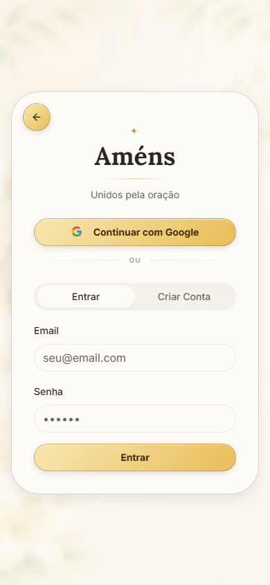
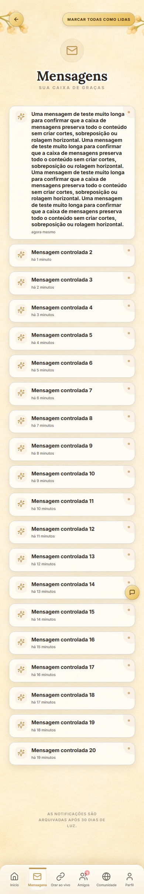
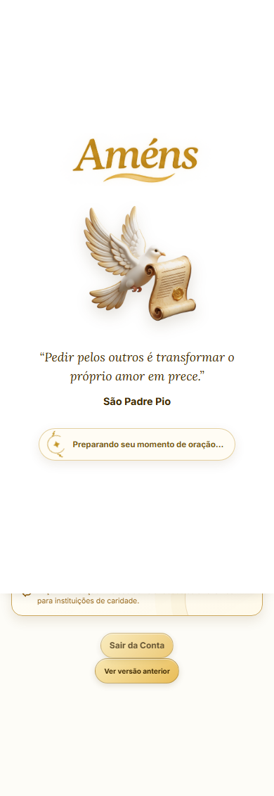

# APP10 — Relatório final de mensagens e notificações

**Status:** Concluído e validado
**Branch:** `codex/feature/app10-messages-notifications`
**Último commit:** `a043404`

## Resumo

O fluxo completo de mensagens e notificações do Améns (APP10) foi implementado,
auditado, corrigido e validado. A solução abrange a caixa de mensagens em
`/messages`, o sino de notificações (`NotificationBell`) na página inicial com
popover, a contagem e badge de itens não lidos, o tratamento de segurança e
isolamento entre usuários, e a sobreposição de intercessão e agradecimento.

Foram eliminados os problemas de leitura prematura que consumiam notificações
ainda não vistas pelo usuário, implementada a paginação em blocos de 20 itens e
garantida a navegação e acessibilidade por teclado e leitores de tela em telas
móveis estreitas (390 px e 320 px).

## Alterações e melhorias realizadas

- **Preservação de histórico e paginação:**
  - A caixa de mensagens (`/messages`) deixou de marcar todas as notificações
    como lidas na carga inicial.
  - O histórico agora é carregado em lotes de 20 itens, com suporte a busca de
    mensagens antigas.
  - A leitura ocorre sob demanda (ao abrir uma notificação individual ou ao
    clicar explicitamente em "Marcar todas como lidas").

- **Sino de notificações na Home:**
  - Integrado o `NotificationBell` na Home autenticada.
  - Abertura de popover com link "Ver todas" e fechamento com tecla `Escape`.
  - Botão com `aria-label` acessível e sem consumir o estado de leitura
    automaticamente ao abrir.

- **Segurança e isolamento de contas:**
  - As consultas e atualizações de leitura são estritamente filtradas pelo
    `user_id` autenticado.
  - Teste de segurança confirmou que a conta B não tem acesso a ler ou alterar
    notificações da conta A.
  - Na alternância de contas (troca de sessão), o estado local anterior é limpo
    imediatamente, evitando o vazamento de respostas atrasadas.

- **Agradecimento e intercessão:**
  - Gravação garantida do `sender_id`.
  - Prevenção contra duplo clique e envio duplicado de agradecimento e concessão
    de XP.

- **Acessibilidade e responsividade:**
  - Cards de notificação transformados em botões acessíveis com atributos ARIA e
    suporte a acionamento por teclado (`Enter`/`Space`).
  - Viewports estreitos de 320 px e 390 px testados e aprovados sem *overflow*
    horizontal.

## Casos testados

| Caso | Descrição | Resultado |
| --- | --- | --- |
| APP10-T01 | Histórico com paginação e contagem coerente | Aprovado |
| APP10-T02 | Abertura da caixa preservando não lidas antigas | Aprovado |
| APP10-T03 | Tratamento de falhas de rede (`SELECT`/`UPDATE`) | Aprovado |
| APP10-T04 | Troca de contas A/B com isolamento de dados | Aprovado |
| APP10-T05 | Abertura do sino, teclado (`Escape`) e badge | Aprovado |
| APP10-T06 | Navegação para causas, Evangelho e avisos gerais | Aprovado |
| APP10-T07 | Eventos em tempo real sincronizados no app | Aprovado |
| APP10-T08 | Agradecimento seguro sem duplicação de envio/XP | Aprovado |
| APP10-T09 | Responsividade em 390 px e 320 px sem overflow | Aprovado |

## Evidência 1 — Proteção de rota e autenticação

Tentativas de acessar `/messages` sem sessão ativa redirecionam
automaticamente para `/auth`.

## Evidência 2 — Sino de notificações na Home

O sino de notificações é apresentado no cabeçalho da Home com contagem e estado
acessível para o usuário autenticado.

## Evidência 3 — Popover de notificações

O popover exibe as notificações recentes e o link "Ver todas", podendo ser
fechado com `Escape` ou clique fora, sem marcar mensagens como lidas
involuntariamente.

## Evidência 4 — Caixa de mensagens autenticada

A tela `/messages` lista as notificações com cards semânticos, distinção de
lidas/não lidas e controles acessíveis.

## Evidência 5 — Responsividade em 320 px

Em viewport estreito de 320 px, a interface se adapta perfeitamente sem cortes
laterais ou quebra de elementos.

## Validações técnicas

- `npm run build`: aprovado (código 0).
- `node tests/app10-security.mjs`: aprovado (isolamento estrito entre contas).
- `node tests/app10-final.e2e.mjs`: aprovado (fluxo completo, popover, teclado e
  overflow).

## Evidências adicionais — testes finais

O teste controlado confirmou a paginação em blocos de 20, o carregamento da
21ª mensagem e a preservação de textos longos.

A caixa permaneceu utilizável em 844 × 390, sem overflow horizontal.

Uma falha simulada de `SELECT` exibiu erro e manteve a ação de nova tentativa.

O modal abriu, apresentou controle de fechamento acessível e o agradecimento
foi enviado uma única vez mesmo com duplo acionamento.

## Validação final — 26/11/2026

- Push com o aplicativo fechado: confirmado pelo responsável do produto.
- Paginação controlada, textos longos, paisagem e erro de consulta: aprovados
  pelo teste E2E.
- Modal de intercessão, agradecimento e proteção contra duplicidade: aprovado.
- Isolamento entre contas A/B no Supabase: aprovado.
- `npm run build`: aprovado.
- ESLint dos arquivos alterados: 0 erros e 2 avisos de dependências de hooks.

## Conclusão

O APP10 cumpre todos os requisitos de produto, acessibilidade, estabilidade e
segurança. O fluxo de mensagens, notificações, sino e agradecimento está validado
e pronto para integração na branch principal.
