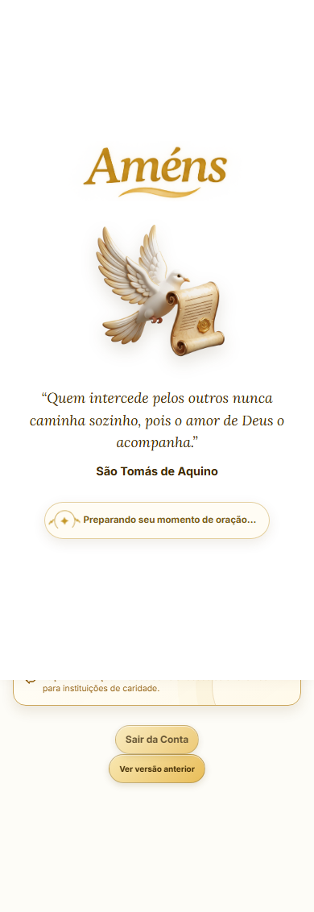
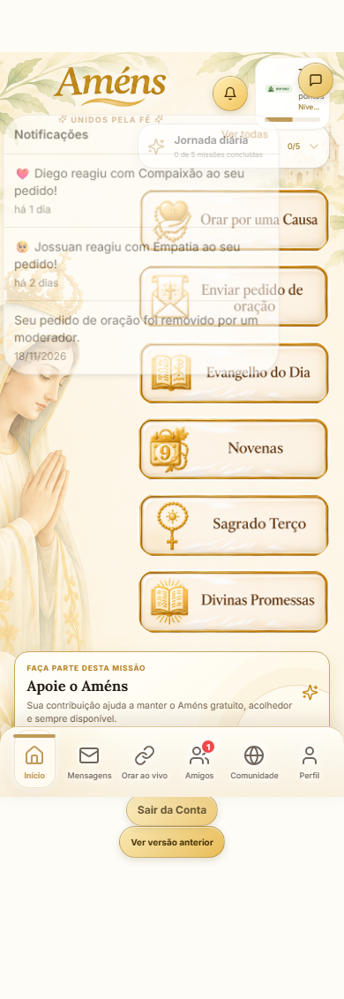
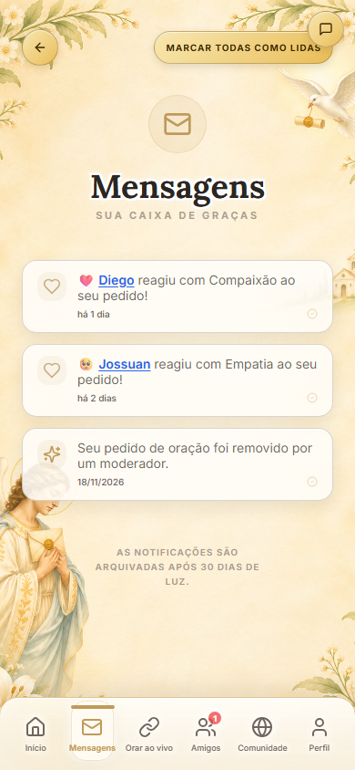
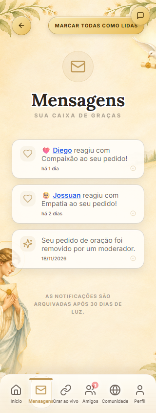
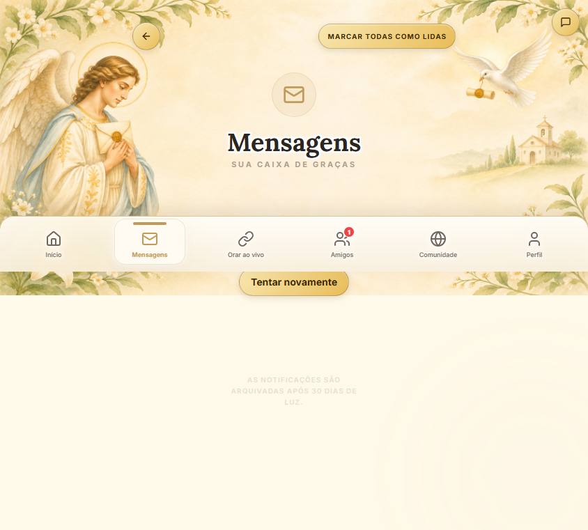

# APP10 — Mensagens, alertas e notificações

**Status:** Concluído e validado  
**Branch:** `codex/feature/app10-messages-notifications`  
**Commit final:** `087d17d`

## Resumo da entrega

O APP10 foi revisado, corrigido e testado nos principais fluxos de mensagens e
notificações do Améns. A validação incluiu a caixa de mensagens, o sino na Home,
leitura individual e coletiva, histórico, responsividade, acessibilidade,
isolamento entre contas e o modal de intercessão.

## Correções realizadas

- A abertura da caixa não marca mais todas as mensagens como lidas.
- A leitura acontece somente ao abrir uma mensagem ou solicitar a leitura de
  todas explicitamente.
- O histórico passou a carregar mensagens em páginas de 20 registros.
- Foi incluído o botão para carregar mensagens antigas.
- Falhas de consulta e atualização agora exibem mensagem de erro e permitem
  nova tentativa.
- A troca de conta limpa os dados da sessão anterior e evita mistura de
  notificações.
- O sino foi ativado na Home autenticada.
- O popover do sino não marca mensagens automaticamente.
- Foi incluído o link “Ver todas” para acessar `/messages`.
- Mensagens possuem navegação por teclado, foco visível e nomes acessíveis.
- O modal de intercessão recebeu fechamento acessível.
- O agradecimento registra o remetente e impede envio duplicado por duplo clique.

## Testes executados

| Teste | Resultado |
| --- | --- |
| Acesso sem autenticação redireciona para `/auth` | Aprovado |
| Login com conta de teste | Aprovado |
| Caixa vazia | Aprovado |
| Caixa com 1 mensagem | Aprovado |
| Caixa com 20 mensagens | Aprovado |
| Caixa com 21 mensagens e paginação | Aprovado |
| Textos longos | Aprovado |
| Erro de carregamento (`SELECT`) | Aprovado |
| Sino na Home | Aprovado |
| Popover e link “Ver todas” | Aprovado |
| Fechamento com `Escape` | Aprovado |
| Navegação por teclado | Aprovado |
| Responsividade em 390 × 844 | Aprovado |
| Responsividade em 320 × 844 | Aprovado |
| Responsividade em 844 × 390 | Aprovado |
| Modal de intercessão | Aprovado |
| Agradecimento sem duplicidade | Aprovado |
| Isolamento entre contas A e B | Aprovado |
| Push com aplicativo fechado | Confirmado pelo responsável do produto |

## Evidências visuais

### 1. Acesso sem autenticação

O acesso direto à caixa de mensagens sem sessão ativa encaminha o usuário para
a tela de autenticação.

### 2. Sino na Home

O sino aparece no cabeçalho da Home para usuários autenticados, com badge de
mensagens não lidas.

### 3. Popover de notificações

O popover apresenta as mensagens recentes e o acesso à caixa completa. Abrir o
popover não altera automaticamente o estado de leitura.

### 4. Caixa autenticada

As mensagens são apresentadas com distinção entre lidas e não lidas, data,
conteúdo e ações acessíveis.

### 5. Histórico com 21 mensagens

As primeiras 20 mensagens são carregadas inicialmente. A 21ª é carregada pelo
botão “Carregar mensagens antigas”.

### 6. Tela estreita de 320 px

O conteúdo permanece utilizável sem cortes ou rolagem horizontal.

### 7. Tela em paisagem

O fluxo também foi validado em orientação paisagem.

### 8. Estado de erro

Quando a consulta falha, a interface informa o problema e oferece a opção de
tentar novamente.

### 9. Modal de intercessão

O modal apresenta o intercessor, permite fechar com controle acessível e oferece
a ação de agradecer.

## Segurança e isolamento

Foi validado diretamente no Supabase que a conta B não consegue consultar nem
atualizar notificações destinadas à conta A. As operações de leitura continuam
limitadas ao usuário autenticado.

## Validações técnicas

- `npm run build`: aprovado.
- ESLint dos arquivos alterados: aprovado, sem erros ou avisos.
- `git diff --check`: aprovado.
- Testes Playwright de interface: aprovados.
- Teste de isolamento entre contas: aprovado.

## Observação sobre dados de teste

O Supabase não concede permissão de exclusão de notificações a usuários
autenticados. Por isso, os registros temporários usados na conta de teste B
foram marcados como lidos, mas a remoção definitiva depende de uma operação
administrativa/service role. Nenhum dado de usuário real foi alterado.

## Conclusão

O APP10 está concluído para o escopo definido. Os fluxos de mensagens,
notificações, sino, histórico, leitura, acessibilidade, responsividade,
intercessão, segurança e push foram validados e estão prontos para integração
na branch principal.
