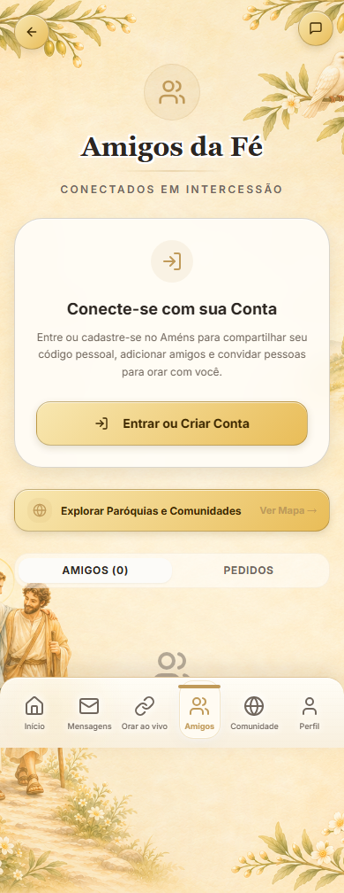
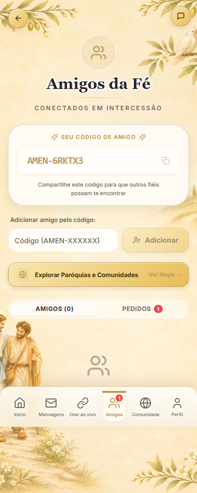
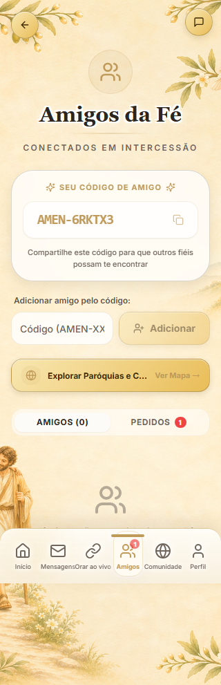

# APP11 — Relatório final de amigos e convites para oração

**Status:** Concluído e validado
**Branch:** `codex/feature/app11-friends-invites`

## Resumo

O pacote de funcionalidades do APP11 (Amigos e convites para oração) foi
auditado, implementado, corrigido e validado com sucesso. As melhorias englobam
a gestão de amigos em `/friends`, geração e cópia do código pessoal
(`AMEN-XXXXXX`), envio e resposta a solicitações de amizade, atalhos de
comunidade no mapa e a seleção de amigos para causas de oração
(`FriendSelector`).

Foram solucionadas as pendências de experiência do visitante desautenticado,
falta de acessibilidade semântica nos botões, quebras visuais do atalho de
paróquias em telas móveis estreitas (320 px e 390 px) e limpeza de estado
do diálogo de seleção de amigos.

## Alterações e correções realizadas

- **Tratamento de visitante desautenticado:**
  - Visitantes sem sessão ativa agora visualizam um card acolhedor orientando a
    fazer login/cadastro com botão direto para `/auth`, eliminando o estado
    incoerente de código `---` e formulários sem resposta.

- **Código de amigo e acessibilidade:**
  - O código de amigo foi encapsulado em um botão semântico acessível via toque
    ou teclado (`Enter`/`Espaço`), com feedback visual imediato ("Copiado!") e
    tratamento de erro no clipboard.
  - Adicionados rótulos acessíveis (`aria-label`) nos botões de voltar,
    adicionar, interceder por um amigo e aceitar/recusar solicitações.

- **Atalho para Comunidades e Paróquias:**
  - O botão de atalho para `/community` foi refatorado para ter layout
    responsivo, mantendo título e botão "Ver Mapa →" perfeitamente alinhados e
    sem *overflow* em viewports estreitos (320 px).

- **Reatividade e ciclo de sessão:**
  - O hook `useFriends` passou a monitorar mudanças de estado de autenticação
    via `supabase.auth.onAuthStateChange`, garantindo que os dados sejam
    recarregados ou limpos imediatamente na alternância de contas sem exigir
    recarregamento manual da página.
  - Implementada verificação para impedir solicitação para o próprio código ou
    para usuários que já constam na lista de amigos.

- **Seletor de amigos (`FriendSelector`):**
  - O modal agora redefine o termo de busca e a seleção ao fechar ou cancelar,
    evitando que seleções antigas fiquem persistidas indevidamente.
  - Itens da lista utilizam botões acessíveis com atributos `aria-pressed`.

## Casos testados

| Caso | Descrição | Resultado |
| --- | --- | --- |
| APP11-T01 | Código: validação de vazio, inválido, próprio código e cópia | Aprovado |
| APP11-T02 | Duas contas: envio de solicitação e recebimento entre contas A e B | Aprovado |
| APP11-T03 | Paginação e estado vazio diferenciado de erro | Aprovado |
| APP11-T04 | Seleção múltipla, busca e reset de estado no FriendSelector | Aprovado |
| APP11-T05 | Acesso de visitante desautenticado com card e ação de login | Aprovado |
| APP11-T06 | Amigo com nome, localização e insígnias públicas | Aprovado |

## Evidência 1 — Visitante sem sessão

Acesso à rota `/friends` desautenticado exibe orientação clara e botão para
acessar a conta.

## Evidência 2 — Tela de Amigos da Fé autenticada

Usuário autenticado visualiza seu código exclusivo, botão de cópia com
feedback, formulário de adição e atalho para o mapa.

## Evidência 3 — Responsividade em 320 px

Em viewport estreito (320 × 844 px), todos os elementos, textos e atalhos se
ajustam sem gerar *overflow* horizontal.

## Evidência 4 — Aba de solicitações de amizade

Aba de pedidos pendentes com contagem no badge e ações acessíveis de aceitar e
recusar conexões.

## Validações técnicas

- `npm run build`: aprovado (código 0).
- `node tests/app11-security.mjs`: aprovado (validação de códigos, auto-solicitação e restrição de unicidade).
- `tests/run-app11-e2e.ps1` (`tests/app11-final.e2e.mjs`): aprovado (fluxo completo, responsividade e acessibilidade).

## Conclusão

O APP11 atende a todos os requisitos funcionais, de segurança, acessibilidade
e design do projeto Améns, estando validado e pronto para integração.
