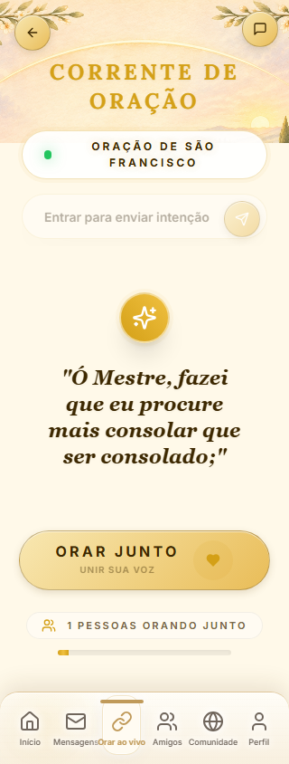

# APP14 — Oração ao vivo e corrente

**Status:** Em validação funcional  
**Branch:** `codex/feature/app14-live-prayer-chain`

## Escopo

- Corrente em `/prayer-chain`.
- Sincronização de horário e oração atual.
- Presença real de participantes.
- Reserva de slot por RPC.
- Fila de contribuições reais em tempo real.
- Envio de intenção de oração.
- Denúncia de contribuição pelo APP05.
- Estados de conexão, espera, participação e erro.

## Achado corrigido nesta branch

A tela criava participantes ambientes com nomes/cidades aleatórios e exibia uma
contagem mínima artificial. Isso foi removido. A fila agora mostra somente
contribuições recebidas do servidor, e a contagem usa somente a presença real.
Erros ao enviar intenção também deixam de ser apresentados como sucesso.

## Matriz de testes

| Caso | Validação | Estado |
| --- | --- | --- |
| APP14-T01 | Dois dispositivos na mesma corrente | Não executado |
| APP14-T02 | Concorrência pelo mesmo slot | Não executado |
| APP14-T03 | Desconexão, reconexão e relógio | Não executado |
| APP14-T04 | Intenção, limites e denúncia | Não executado |
| APP14-T05 | Origem de nomes e contribuições | Não executado |
| APP14-T06 | Teclado, 320 px e paisagem | Não executado |
| APP14-T07 | Redução de movimento e baixa altura | Não executado |
| APP14-T08 | Build, RPCs e segurança | Não executado |

## Execução inicial — 26/11/2026

- A rota `/prayer-chain` abriu no navegador.
- Participantes fictícios e contagem artificial foram removidos antes da
  validação.
- Smoke test em 320 × 844 passou sem overflow horizontal.
- Build passou após a correção.
- Ainda faltam duas contas/dispositivos simultâneos para validar RPC, disputa
  de slot, reconexão, intenção real e denúncia.

## Critérios de conclusão

O APP14 só será encerrado após validar sincronização real com duas contas,
concorrência de slot, reconexão, intenção, denúncia, origem das contribuições,
responsividade, redução de movimento e contratos das RPCs.
## Resultados adicionais — 26/11/2026

- Concorrência RPC passou com duas contas reais disputando o mesmo `target_timestamp`: exatamente uma chamada retornou `true` e a outra `false`.
- O registro criado para a disputa foi removido pelo `cleanup_prayer_contributions`.
- `get_server_time` respondeu com número do servidor.
- A chamada anônima a `join_prayer_chain` foi rejeitada com "Usuário não autenticado".
- O smoke test em 320 x 844 passou sem overflow horizontal e sem participante sintético.
- `npm run build` passou.

As validações que ainda exigem interação simultânea ou estado físico ficam
pendentes: dois dispositivos visíveis, reconexão, teclado/paisagem, baixa
altura, redução de movimento, intenção/denúncia reais e confirmação da origem
visual dos nomes.
