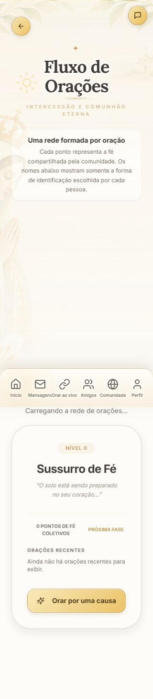

# APP15 — Prayer flow and network visualization

**Status:** Initial implementation complete; validation in progress  
**Branch:** `codex/feature/app15-prayer-network`

## Product decisions

- `/tree` is public.
- The network shows the name selected by each user only when the profile allows public display.
- Anonymous prayer requests and profiles without public-name consent are rendered as `Intercessor`.
- The official aggregate remains `Pontos de Fé Coletivos`.
- The existing Remotion visualization is preserved with a textual equivalent and a reduced-motion path.

## Changes in this branch

- Added explicit loading, empty, and Supabase error states.
- Added retry action when network data cannot be loaded.
- Added a plain-language explanation of the network and its names.
- Added a recent-prayers text list as an equivalent to the animated names.
- Applied prayer-request status/deletion filters before displaying activity.
- Enforced the profile privacy choice when resolving displayed names.
- Kept the `Orar por uma causa` CTA available independently of animation state.
- Added reduced-motion behavior and removed random sparkle positioning from the page.
- Added a deterministic Playwright smoke test and a current screenshot.

## Validation matrix

| Case | Result |
| --- | --- |
| APP15-T01 — direct route, back, and `/pray` CTA | Smoke passed for direct route and CTA; back action is present and needs manual confirmation |
| APP15-T02 — loading, populated, empty, and error states | Smoke passed for populated state; controlled empty state and 503 failure state passed |
| APP15-T03 — privacy fallback | Logic implemented for anonymous requests and hidden names; account-level confirmation pending |
| APP15-T04 — reduced motion, keyboard, enlarged text | Reduced-motion smoke passed; keyboard and enlarged-text checks pending |
| APP15-T05 — 320px, landscape, desktop, low height | 320px smoke passed; remaining viewports pending |
| APP15-T06 — themes | Pending |
| APP15-T07 — build and deterministic smoke | `npm run build` and smoke passed |

## Evidence

- `npm run build` passed.
- `node tests/app15-tree-smoke.e2e.mjs` passed against the local Vite server.
- The smoke test verified public access, explanatory text, reduced motion, no horizontal overflow at 320px, and navigation to `/pray`.
- A controlled empty response showed the empty-network state without synthetic activity.
- A controlled 503 response showed the error state and retry action.

## Remaining validation

Manual checks still required: two privacy configurations with real test accounts,
keyboard/enlarged text, landscape and low-height viewports, both themes, and
back navigation.
