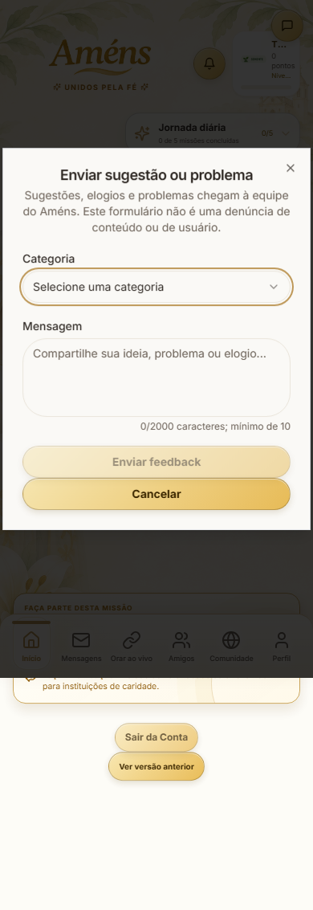

# APP18 — Enviar sugestão ou problema à equipe

**Status:** Implementação local concluída; migration de resposta pendente de aplicação  
**Branch:** `codex/feature/app18-feedback-suggestions`

## Correções realizadas

- O feedback exige sessão autenticada antes do envio.
- Categorias e mensagem continuam validadas no cliente e no banco.
- O diálogo informa que sugestão/problema é diferente de denúncia de conteúdo ou usuário.
- Labels foram ligados aos controles.
- O contador informa limite de 2000 caracteres e mínimo de 10.
- O nome de fechamento permanece acessível pelo componente de diálogo.
- Falhas preservam o texto para nova tentativa.
- Cancelamento limpa o rascunho ao fechar.
- Respostas administrativas passaram a usar uma RPC transacional.
- A notificação e a marcação do feedback como respondido agora são concluídas juntas ou falham juntas.

## Validações realizadas

- Usuário autenticado abriu o diálogo.
- Categoria foi selecionada corretamente.
- Campo de mensagem ficou acessível e visível.
- Explicação diferenciando feedback de denúncia foi exibida.
- Cancelamento e limpeza do rascunho foram aprovados.
- `npm run build` aprovado.
- `git diff --check` aprovado.
- `node tests/app18-feedback-smoke.e2e.mjs` aprovado.

## Evidência

## Migration

Foi criada a migration:

`supabase/migrations/20261128010000_app18_feedback_reply_rpc.sql`

Ela cria `reply_to_user_feedback`, que valida moderador/admin e envia a resposta
junto com a notificação de forma transacional. A migration ainda precisa ser
aplicada no SQL Editor do Supabase antes de testar a resposta administrativa.

## Próximos testes após aplicar a migration

- Enviar feedback real com uma conta de teste.
- Confirmar que aparece no painel administrativo.
- Responder pelo painel e verificar a mensagem na conta remetente.
- Confirmar que outro usuário não consegue consultar o feedback.
- Forçar falha de resposta e confirmar que nenhuma das duas gravações fica parcial.
